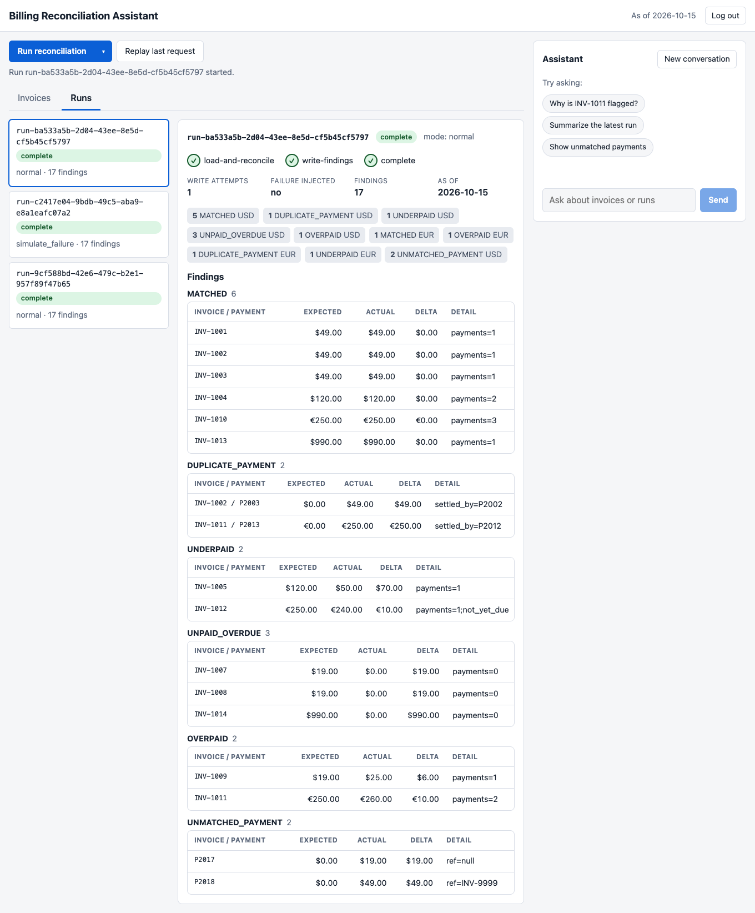
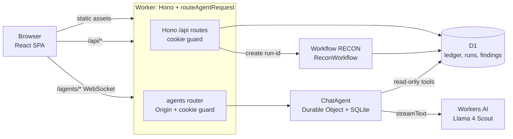

# Billing Reconciliation Assistant

An AI-assisted billing reconciliation MVP that runs entirely on Cloudflare. A deterministic engine compares a synthetic ledger of subscriptions, invoices and payments, then reports six kinds of discrepancy (17 findings on the seed data). Runs are idempotent and execute as a Cloudflare Workflow with a demonstrable transient-failure retry. A chat assistant (Workers AI, Llama 4 Scout) answers questions about the results using read-only tools, and its conversations persist in a Durable Object.



## What it demonstrates

| Theme                           | Mechanism                                                                                                                                                                                                                                      |
| ------------------------------- | ---------------------------------------------------------------------------------------------------------------------------------------------------------------------------------------------------------------------------------------------- |
| Financial correctness           | All money is integer minor units (`Number.isSafeInteger` enforced). `reconcile()` is a pure, synchronous function with a fixed total ordering, tested against a hand-authored expected-findings fixture. Currencies are never summed together. |
| Reliable async processing       | `POST /api/runs` takes an `Idempotency-Key`. Run ids and finding ids are deterministic, D1 constraints enforce uniqueness, and a Workflow executes the steps with platform retries.                                                            |
| Persistent conversational state | `ChatAgent` (an `AIChatAgent` Durable Object with SQLite storage) keeps each conversation's messages, supports resumable streams, and restores history on reload.                                                                              |
| Practical AI                    | The model only calls four read-only tools backed by fixed parameterised SELECTs. Amounts arrive pre-formatted from the server, and the prompt forbids arithmetic and guessing.                                                                 |

## Architecture



| Component    | File                                               | Role                                                                                                              |
| ------------ | -------------------------------------------------- | ----------------------------------------------------------------------------------------------------------------- |
| Worker entry | `src/server/index.ts`                              | Hono app; `/api/*` routers; `/agents/*` forwarded to `routeAgentRequest`; exports `ChatAgent` and `ReconWorkflow` |
| Auth         | `src/server/auth.ts`                               | Passcode check, HMAC-signed session cookie, `/agents` Origin check, sid propagation                               |
| Engine       | `src/server/engine/reconcile.ts`                   | Pure `reconcile(dataset, asOfDate)`                                                                               |
| Runs         | `src/server/runs.ts`, `src/server/api/runs.ts`     | Idempotent run creation, `ensureWorkflow`, conditional state updates                                              |
| Workflow     | `src/server/workflow.ts`                           | `load-and-reconcile` -> `write-findings` -> `complete` (+ `mark-errored`)                                         |
| Chat agent   | `src/server/agent.ts`, `src/server/agent-tools.ts` | `AIChatAgent`, system prompt, read-only tools, guardrails                                                         |
| Client       | `src/client/**`                                    | React 19 SPA using `useAgent` / `useAgentChat`                                                                    |
| Storage      | `migrations/0001_init.sql`                         | 5 D1 tables: `subscriptions`, `invoices`, `payments`, `reconciliation_runs`, `findings`                           |

Storage split: the ledger, runs and findings live in D1, which is the single source of truth for correctness and is shared by the Worker, the Workflow and the agent's tools. Conversation messages live in the Durable Object's own SQLite storage, because they are per-conversation state that only the agent touches.

## Key decisions and trade-offs

### D1. Run orchestration: Workflows as a thin shell

- **Chosen:** [Cloudflare Workflows](https://developers.cloudflare.com/workflows/build/workers-api/) with three steps. D1 remains the only authority for run status.
- **Alternatives:** a synchronous Worker handler running the same idempotent batch (same correctness guarantee, but the retry demo would be a hand-written loop); a Durable Object with alarms (reimplements Workflows retry, strictly worse).
- **Why:** idempotency comes from `UNIQUE(idempotency_key)`, hash primary keys and `ON CONFLICT DO NOTHING`, not from Workflows. The Workflow adds platform-visible step status and real [retry with backoff](https://developers.cloudflare.com/workflows/build/sleeping-and-retrying/), so a misbehaving instance can never corrupt state. See the [rules of Workflows](https://developers.cloudflare.com/workflows/build/rules-of-workflows/).
- **Cost:** an extra binding, [instance retention](https://developers.cloudflare.com/workflows/reference/pricing/) of 3 days on the Free plan, real retry delays in dev (2s, 4s), and recovery logic for runs whose instance was never created. The synchronous handler is the documented fallback.

### D2. Chat runtime: `AIChatAgent` + `useAgentChat`

- **Chosen:** [`AIChatAgent`](https://developers.cloudflare.com/agents/agent-class/communication-channels/chat/chat-agents/) with the official [React client hooks](https://developers.cloudflare.com/agents/agent-class/communication-channels/chat/client-sdk/).
- **Alternatives:** a plain Durable Object with `env.AI.run` and a custom WebSocket protocol (3-5x the code); history in `localStorage` (client-controlled, caps bypassable); `useChat` over HTTP with messages in a D1 table (stable APIs, but no resumable streams and hand-written persistence).
- **Why:** persistent per-conversation memory, resumable streams and history hydration come with the SDK.
- **Cost:** pre-1.0 packages (pinned exactly: `agents` 0.32.0, `@cloudflare/ai-chat` 0.12.2), WebSocket auth plumbing (cookie on upgrade, Origin check, sid propagated into the Durable Object), and harder unit testing.

### D3. HTTP routing: Hono

- **Chosen:** Hono with `@hono/zod-validator`. `/agents/*` is handled by calling `routeAgentRequest` directly from a Hono route.
- **Alternatives:** a hand-rolled `URLPattern` table (zero dependencies, but every route, middleware and error path would be owned code); `hono-agents` (a thin wrapper with its own release cadence).
- **Why:** typed bindings, composable sub-routers, central error handling, and in-process testing. Run workers [first for `/api/*` and `/agents/*`](https://developers.cloudflare.com/workers/static-assets/binding/#run_worker_first) while serving the [SPA](https://developers.cloudflare.com/workers/static-assets/routing/single-page-application/) from static assets.
- **Cost:** one extra small dependency. Hono's `cors()`/`csrf()` are deliberately not used (same-origin app; the agent Origin rule is custom).

### D4. Deterministic finding ids

- **Chosen:** `reconcile()` stays synchronous and emits a natural key plus `seq`. The Workflow computes `id = SHA-256("v1|" + run_id + "|" + kind + "|" + invoice_id + "|" + payment_id)` with Web Crypto.
- **Alternatives:** a vendored synchronous SHA-256 (about 80 lines of crypto to own); an async engine (contaminates purity).
- **Why:** a retried write produces the same ids, so `ON CONFLICT(id) DO NOTHING` makes it a no-op.
- **Cost:** id hashing lives outside the engine.

### Model: Llama 4 Scout instead of Llama 3.3 70B

- **Chosen:** `@cf/meta/llama-4-scout-17b-16e-instruct` (131k context; see [pricing](https://developers.cloudflare.com/workers-ai/platform/pricing/)).
- **Alternative:** [Llama 3.3 70B fp8-fast](https://developers.cloudflare.com/workers-ai/models/llama-3.3-70b-instruct-fp8-fast/), which supports [function calling](https://developers.cloudflare.com/workers-ai/features/function-calling/) but has a 24k context window and one external report of tool calls leaking as text when streaming.
- **Cost:** tool-calling quality is only checked manually, since tests never call the model. The model id is a single constant (`MODEL_ID` in `src/server/agent.ts`).

### UI: React instead of Vue

- **Chosen:** React 19.
- **Alternative:** Vue via `@ai-sdk/vue` with `WebSocketChatTransport` (see the [vue-chat example](https://github.com/cloudflare/agents/tree/main/examples/vue-chat)). The transport does not hydrate history or auto-resume, so it would need an undocumented `get-messages` workaround. The `useAgent` / `useAgentChat` hooks are React-only.
- **Cost:** none for this scope.

### Access control: passcode + HMAC cookie + rate limits

- **Chosen:** a shared passcode exchanged for an HMAC-signed `recon_session` cookie (12h, `SameSite=Strict`, `Secure`, carrying a random session id), an Origin check on WebSocket upgrades, `LOGIN_LIMITER` (5/min per IP) and `CHAT_LIMITER` (10/min per session).
- **Rejected:** a Worker-level Cloudflare Access toggle, which returns 403 on WebSocket upgrades and breaks Agents chat; Basic Auth (unreliable with WebSockets); Turnstile (a bot check, not authentication).
- **Why:** a public demo that calls Workers AI must not be open, and this works with WebSockets.
- **Cost:** a shared secret, not per-user identity. See [Hardening](#hardening-and-next-steps).

## Reconciliation rules

All amounts are integer minor units (for example 4900 = 49.00 USD). The as-of date is the `AS_OF_DATE` var in `wrangler.jsonc` (`2026-10-15`).

| Kind                | Definition                                                                                                                                                                                                     |
| ------------------- | -------------------------------------------------------------------------------------------------------------------------------------------------------------------------------------------------------------- |
| `matched`           | Net payments equal the invoice amount (also a zero-amount invoice with no payments).                                                                                                                           |
| `underpaid`         | Net payments are greater than 0 and below the amount. Delta is the shortfall. `detail` says whether the due date has passed.                                                                                   |
| `overpaid`          | Net payments exceed the amount. Delta is the excess.                                                                                                                                                           |
| `unpaid_overdue`    | No payments and `due_at < as_of`. Delta is the full amount. A not-yet-due unpaid invoice produces no finding.                                                                                                  |
| `duplicate_payment` | Among payments whose amount equals the invoice amount, every one after the first (ordered by `received_at`, then id) is a duplicate. Delta is the payment amount; `detail` names the first (settling) payment. |
| `unmatched_payment` | A payment whose `invoice_ref` is null or matches no invoice.                                                                                                                                                   |

Details that matter:

- **As-of semantics:** payments with `received_at > as_of` are ignored. An invoice is overdue only if `due_at < as_of`, so an invoice due exactly on the as-of date is not overdue.
- **Duplicate vs overpaid:** only full-amount payments can be duplicates, and only when there are two or more. Identical partial payments are never duplicates. A single full payment arriving after partials that already settled the invoice is `overpaid`, not `duplicate_payment`. Duplicates are excluded from the net total, so an invoice with two full payments plus a small extra payment emits both a `duplicate_payment` and an `overpaid` finding, and their deltas sum to the total excess cash.
- **Validation:** a Zod schema checks the dataset before reconciling. Non-integer amounts, unsupported currencies (only USD and EUR), duplicate ids, or a payment whose currency differs from its invoice cause the run to fail (`errored`) instead of producing a finding.
- **Ordering:** findings are sorted by invoice id, then kind rank, then payment id, and numbered with `seq`. Every read uses `ORDER BY seq`.

### Seed scenarios (as-of 2026-10-15)

15 invoices, 18 payments, 17 findings: matched 6, underpaid 2, overpaid 2, duplicate_payment 2, unpaid_overdue 3, unmatched_payment 2.

| Invoice        | Scenario                                     | Expected findings                                 |
| -------------- | -------------------------------------------- | ------------------------------------------------- |
| INV-1001       | Paid in full                                 | matched                                           |
| INV-1002       | Full payment, then the same amount again     | matched; duplicate_payment (P2003, 4900)          |
| INV-1003       | Paid in full on the due date                 | matched                                           |
| INV-1004       | Two identical partials summing to the total  | matched                                           |
| INV-1005       | Partial payment, overdue                     | underpaid (7000)                                  |
| INV-1006       | Unpaid, due on the as-of date                | none                                              |
| INV-1007, 1008 | Unpaid, overdue                              | unpaid_overdue (1900 each)                        |
| INV-1009       | Paid 2500 on a 1900 invoice                  | overpaid (600 USD)                                |
| INV-1010       | Three partials summing to the total (EUR)    | matched                                           |
| INV-1011       | Two full payments plus 1000 extra (EUR)      | overpaid (1000); duplicate_payment (P2013, 25000) |
| INV-1012       | Partial payment, due on the as-of date (EUR) | underpaid (1000, not yet due)                     |
| INV-1013       | Paid in full (net-30)                        | matched                                           |
| INV-1014       | Unpaid, overdue (99000)                      | unpaid_overdue                                    |
| INV-1015       | Unpaid, not yet due                          | none                                              |
| none           | P2017: 1900, no invoice ref                  | unmatched_payment                                 |
| none           | P2018: 4900, ref `INV-9999`                  | unmatched_payment                                 |

## Idempotency and retry

1. The client sends `Idempotency-Key: <uuid>` and `{mode: "normal" | "simulate_failure"}`.
2. The server inserts a run with `id = "run-" + key` and `ON CONFLICT(idempotency_key) DO NOTHING`. A new row returns `202`; a replay returns `200` with `duplicate: true` and the same run. The same key with a different mode returns `422 idempotency_key_mismatch`.

**Demo reset.** **Reset data** in the header calls `DELETE /api/runs`, which deletes every run and finding in one batch; invoices and payments stay. An in-flight Workflow becomes a no-op because each of its writes requires the run row. Workflows keeps finished instances (and refuses their IDs) until the retention limit, so a key used before the reset returns `409 idempotency_key_retired` instead of creating a run that could never start; the UI forgets its last key on reset. 3. The Workflow instance id equals the run id. `ensureWorkflow` calls `RECON.create({id})` and, on any error, confirms the instance exists with `get(id).status()`. If that fails too, the API returns `503` and the row stays `queued`, so replaying the same request recovers it. `GET /api/runs/:id` does the same for a `queued` run older than 10 seconds (an idempotent side effect that changes no D1 row). 4. D1 is the sole status authority. Every state `UPDATE` carries `WHERE status NOT IN ('complete','errored')`, and the findings `INSERT`s are guarded by `WHERE EXISTS (...)` on a non-terminal run, so a late or duplicate Workflow write cannot change a finished run. 5. `write-findings` is one `DB.batch` of guarded inserts (`ON CONFLICT(id) DO NOTHING`) plus an increment of `write_attempts`. Retries use `{limit: 3, delay: 2s, exponential}`.

**Simulated failure demo:** in `simulate_failure` mode the first `write-findings` attempt throws after its batch commits. The Workflow retries, the inserts become no-ops, `write_attempts` ends at 2, and the run completes with exactly 17 findings (no duplicates).

## AI assistant

**Tools** (all read-only, fixed SQL with numbered parameters, amounts returned as `{minor, formatted}`):

| Tool            | Returns                                                                                        |
| --------------- | ---------------------------------------------------------------------------------------------- |
| `listRuns`      | Recent runs (default 10, max 20)                                                               |
| `getRunSummary` | Finding counts and total deltas per kind and currency for a run (default: latest complete run) |
| `listFindings`  | Findings for a run, optionally filtered by kind (max 50)                                       |
| `getInvoice`    | Invoice, subscription, payments and findings, or `found: false`                                |

**Grounding rules** (system prompt): call tools before any factual answer; answer only from tool results; cite record ids (`INV-…`, `P…`, `run-…`); use `formatted` amounts verbatim and never compute, convert or sum amounts across currencies; say a record cannot be found when `found: false`; refuse any request to modify data or start a run; stay concise. The tool loop stops after 5 steps.

**Guardrails:**

- **Fail closed:** a missing session id in the chat turn produces a "Session expired" assistant message and no model call.
- **Rate limit:** 10 messages per minute per session (`CHAT_LIMITER`).
- **Conversation cap:** 40 user messages per conversation; the Durable Object persists at most 200 messages. "New conversation" starts a fresh count by design, so the per-session `CHAT_LIMITER` (10 messages/minute) is the real spend control.
- **Persistence:** messages live in the `ChatAgent` Durable Object's SQLite storage. The conversation id comes from `?c=`, then `localStorage`, then a new UUID.

## API reference

All bodies are JSON. Everything except `POST /api/session` and `GET /api/health` requires a valid session cookie (401 otherwise).

| Method | Path                                 | Request                                         | Response                                                                                                                          | Status                                                                                                |
| ------ | ------------------------------------ | ----------------------------------------------- | --------------------------------------------------------------------------------------------------------------------------------- | ----------------------------------------------------------------------------------------------------- |
| GET    | `/api/health`                        | none                                            | `{ok: true}`                                                                                                                      | 200                                                                                                   |
| POST   | `/api/session`                       | `{passcode}`                                    | `{ok: true}` + `Set-Cookie`                                                                                                       | 200; 400; 401 wrong passcode; 429                                                                     |
| GET    | `/api/session`                       | cookie                                          | `{authenticated, expiresAt}`                                                                                                      | 200; 401                                                                                              |
| DELETE | `/api/session`                       | none                                            | clears cookie                                                                                                                     | 204                                                                                                   |
| GET    | `/api/invoices`                      | none                                            | `{asOfDate, latestRunId, invoices[]}`; status is `matched`, `underpaid`, `overpaid`, `unpaid_overdue`, `open` or `not_reconciled` | 200                                                                                                   |
| POST   | `/api/runs`                          | header `Idempotency-Key: <uuid>`; body `{mode}` | `{run, duplicate}`                                                                                                                | 202 new; 200 duplicate; 400; 409 key used before a reset; 422 mode mismatch; 503 workflow unconfirmed |
| DELETE | `/api/runs`                          | none                                            | `{deleted: {runs, findings}}` (demo reset; ledger kept)                                                                           | 200                                                                                                   |
| GET    | `/api/runs`                          | `?limit` (max 50)                               | `{runs[]}` newest first                                                                                                           | 200                                                                                                   |
| GET    | `/api/runs/:id`                      | none                                            | run with `status`, `current_step`, `write_attempts`, `findings_count`, `summary`                                                  | 200; 404                                                                                              |
| GET    | `/api/runs/:id/findings`             | `?kind=`                                        | `{findings[]}` ordered by `seq`                                                                                                   | 200; 400; 404                                                                                         |
| any    | `/agents/chat-agent/:conversationId` | WebSocket upgrade or HTTP                       | Agents SDK protocol                                                                                                               | 401 no cookie; 403 bad Origin on upgrade                                                              |

## Getting started

**Prerequisites**

- Node 24 (`engines`: `>=24 <25`)
- [Corepack](https://nodejs.org/api/corepack.html) enabled (`corepack enable`), which fetches the pinned pnpm 12.16.1
- A Cloudflare account and `wrangler login`. The Workers AI binding is always remote, so `pnpm run dev` fails without Cloudflare authentication and chat requests are billed against your account (10k neurons/day free).

```bash
cp .dev.vars.example .dev.vars   # then set DEMO_PASSCODE and SESSION_SECRET
pnpm install
pnpm run setup:local             # apply migrations + seed the local D1
pnpm run dev                     # http://localhost:5173
```

Generate a secret with `openssl rand -base64 32`. Sign in with the passcode you set.

**Tests**

```bash
pnpm test
```

Runs 104 tests: 53 unit (Node: engine, money, auth, dataset hash, read-only DB) and 51 integration (workerd via `@cloudflare/vitest-plugin`: schema, runs and Workflow retry, API, auth, agent tools, chat guard). The AI binding is a stub that throws, so Workers AI is never called and tests need no network or login. Expect harmless `uncaught exception` log lines from the stub and the simulated failure.

**Typecheck and build**

```bash
pnpm run typecheck
pnpm run build
```

## Deploy

```bash
pnpm exec wrangler d1 create recon-db          # copy database_id into wrangler.jsonc
pnpm exec wrangler secret put DEMO_PASSCODE
pnpm exec wrangler secret put SESSION_SECRET
pnpm run db:migrate:remote
pnpm run db:seed:remote
pnpm run deploy                          # prints https://recon-assistant.<subdomain>.workers.dev
```

The checked-in `database_id` is a placeholder that works for local dev and tests only.

## Demo script

1. Open the app and sign in with the passcode. Invoices show `not_reconciled`.
2. Click **Run reconciliation**. The run progresses through three steps and completes with 17 findings; invoice statuses update.
3. Click **Replay last request**. The same run returns with a "duplicate" banner and no new findings.
4. Click **Run with simulated failure**. When complete, the run shows `write_attempts = 2` and still 17 findings.
5. Open the findings view and check INV-1011: both overpaid (1000) and duplicate_payment (25000).
6. In chat, ask "Why is INV-1011 flagged?". The answer cites P2013 and shows tool calls.
7. Reload the page. The conversation is restored from the Durable Object.
8. Send 11 quick messages. The 11th within a minute is rejected with a slow-down message.
9. Click **Reset data** and confirm. Runs and findings are gone and invoices show `not_reconciled` again.

## Known limitations

- **Global data and runs:** the dataset, runs and findings are shared, not per session. Everyone with the passcode sees the same runs, and invoice statuses follow the latest run whoever started it. Manual reset:
  ```bash
  pnpm exec wrangler d1 execute DB --remote --command "DELETE FROM findings; DELETE FROM reconciliation_runs;"
  ```
  (use `--local` for local dev).
- **AI is remote in dev:** local chat calls the real Workers AI and consumes neurons.
- **3-day Workflow retention** on the Free plan. This does not affect correctness, because D1 holds the run state.
- **Shared passcode:** no per-user identity or audit trail.
- **WebSockets outlive the cookie:** an open WebSocket is not closed when the 12h session cookie expires.
- **No global daily AI spend cap:** the Free plan refuses requests beyond 10k neurons/day rather than billing. On a paid plan only the per-session limiter and 40-message cap apply.
- **Currency mismatch fails the run:** a payment/invoice currency mismatch ends the run as `errored` rather than producing a finding.
- **Stuck `running` state:** a run can stay `running` if the `mark-errored` step itself fails.
- **Payments after the as-of date are excluded** by the engine.
- **Safari and `Secure` cookies on localhost:** the session cookie is always `Secure`. Chrome and Firefox treat localhost as a secure context; Safari may not store it.
- **Manual-only checks:** the model's wording and tool-call quality are verified by hand, not in tests.
- **Pre-1.0 dependencies:** `agents` and `@cloudflare/ai-chat` are pinned exactly and may change between releases.
- **`compatibility_date` is `2026-10-30`**, the newest date the installed workerd supports. Bump it when workerd updates.

## Hardening and next steps

- **Cloudflare Access:** protect the app with a hostname-based Access application (not the Worker-level toggle, which breaks WebSocket upgrades) and validate the `Cf-Access-Jwt-Assertion` JWT in the Worker with `jose`, checking issuer and audience. This replaces the shared passcode with real identities.
- **Global daily AI cap:** a date-keyed counter to bound spend across all sessions.
- **Observability:** enable `observability.traces` in addition to logs.
- **More finding kinds:** fuzzy invoice matching and a dedicated currency-mismatch / price-mismatch kind instead of failing the run.
- **Operations:** close WebSockets when the cookie expires; a cron sweeper for stuck runs; compare Llama 3.3 and GLM 4.7 Flash for tool-calling quality.

## Project structure

```
wrangler.jsonc            Worker, D1, Durable Object, Workflow, AI, rate limits
vite.config.ts            React + Cloudflare Vite plugin
vitest.config.ts          "unit" (Node) and "integration" (workerd, AI stub) projects
index.html
migrations/0001_init.sql  5-table schema
seed/seed.sql             Idempotent seed dataset
docs/screenshot-run.png
src/
  shared/                 types.ts, money.ts (formatMinor)
  server/
    index.ts              Hono app, route wiring, class exports
    http.ts               AppEnv, error mapping, session middleware
    auth.ts               Cookie signing, passcode check, guard
    api/                  session.ts, invoices.ts, runs.ts
    engine/               reconcile.ts, types.ts
    dataset.ts            loadDataset, datasetHash
    runs.ts               ensureWorkflow, run state SQL
    workflow.ts           ReconWorkflow
    findings.ts           Deterministic finding ids
    agent.ts              ChatAgent (AIChatAgent)
    agent-tools.ts        Read-only tools, system prompt, preflight
  client/
    main.tsx, App.tsx, api.ts, styles.css
    components/           LoginForm, InvoicesTable, RunControls, RunDetail,
                          RunsList, FindingsView, StatusBadge, ChatPanel
test/
  fixtures/               seed-dataset.ts, expected-findings.json (hand-authored)
  unit/                   reconcile, money, auth, readonly-db, dataset-hash
  integration/            schema, runs, api, auth, agent-tools, chat-guard, smoke
```
